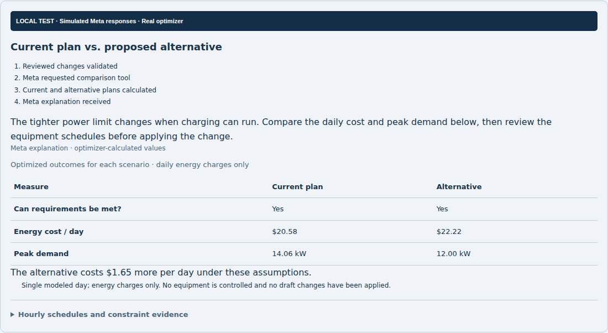

# Local Meta comparison test and examples

Tested November 4, 2026, on the local branch containing main through PR #73.

The screenshots show the actual local React interface and real FastAPI/OR-Tools
calculations for fictional building inputs. **Meta SDK responses are injected.**
No live Meta request, paid inference, deployment or production change occurred.
The visible dark test banner is added only by the browser harness.

## Examples a user can try

| User request | Observed result for this fictional example |
| --- | --- |
| “Compare my current plan with a 12 kW building power limit.” | Daily optimized energy charges $20.58 → $22.22; peak 14.06 → 12.00 kW. The stricter limit can be met, at higher modeled energy cost. |
| “Why does the tighter limit cost more?” | Follow-up receives the exact current and alternative retained execution IDs. No additional solver call is made by the conversation endpoint. Wording in this test is injected. |
| “Compare my current plan with a 1 kW building power limit.” | Alternative is infeasible; optimized cost, peak and cost difference remain unavailable. The existing plan stays intact. |
| “Compare a 25 percent increase in the peak electricity price.” | Daily optimized energy charges $20.58 → $22.82. The UI explicitly identifies a changed tariff assumption, rather than operational savings. |
| Meta returns an invalid numerical explanation | The unsupported claim is rejected. The UI keeps the verified comparison and identifies the explanation as unavailable. |

The unchanged example starts with a 25 kW site limit, joint EV/flexible scheduling,
two configured EVs and synthetic building demand. These results cover a single
modeled day and energy charges only. They are not actual customer savings or a
complete utility bill. Cost differences are computed before display rounding.

## Screenshots

- [Proposal review](01-review-proposal-desktop.png)
- [Desktop comparison](02-comparison-desktop.png)
- [Device schedules](03-device-schedules-desktop.png)
- [Mobile comparison](04-comparison-mobile.png)
- [Follow-up conversation](05-follow-up-desktop.png)
- [Infeasible alternative](06-infeasible-desktop.png)
- [Different tariff assumption](07-tariff-comparison-desktop.png)
- [Explanation unavailable, results preserved](08-explanation-unavailable-desktop.png)
- [Comparison inside the app](09-comparison-in-app-desktop.png)



## Verification

- Four full HTTP comparison flows through the real backend and solver.
- Both costs independently recomputed from hourly demand × submitted prices;
  equipment energy, power, availability windows and site limits checked.
- Each comparison dispatches the tool exactly once. SDK responses are injected
  below the application logic; comparison routes and responses are not replaced.
- Follow-ups reference both exact retained results.
- A draft changes only after explicit **Apply Changes**.
- No JavaScript page errors in the completed browser run.
- No horizontal clipping in the comparison table at 1440, 768, 390 or 320 pixels.
- Automated WCAG A/AA scans report zero violations **within the comparison card**
  at those four widths. This is not a full-site accessibility certification.
- Focused frontend suite: 24 passed. Focused backend comparison suite: 23 passed.
- TypeScript and production build pass, with the existing large-bundle warning.

The first browser run identified inherited `white-space: nowrap` clipping the
alternative column and making the scroll region inaccessible on narrow screens.
The comparison table now uses a fixed layout with wrapping. The final browser
checks explicitly verify internal table width as well as page width. An
intermediate rerun also exposed a test-harness counter that included previous
runs; the final runner measures SDK calls relative to its own starting point.

Raw requests, results, injected-tool evidence, accessibility findings and checks
are saved in [browser-results.json](browser-results.json).

## Reproduction

The test runner requires Playwright, Chromium and `@axe-core/playwright`. The
session reused cached packages in `/tmp/gridpilot-browser-tools`; application
dependencies and environment files were not changed.

```bash
# Start servers, run the browser checks, then stop the owned servers:
python3 artifacts/meta-comparison-local-test/qa_run.py

# Alternatively, manage the servers in separate terminals:
# Terminal 1: local-only fake SDK + real application/solver
backend/.venv/bin/python artifacts/meta-comparison-local-test/qa_backend.py

# Terminal 2: local frontend
VITE_API_BASE_URL=http://127.0.0.1:8411 npm --prefix frontend run dev -- --host 127.0.0.1 --port 5411

# Terminal 3: real Chromium workflow, screenshots and evidence
node artifacts/meta-comparison-local-test/browser.cjs
```

Do not deploy `qa_backend.py`. It is an isolated QA launcher that replaces the
provider client and adds test-only control routes. Production code never imports
it. Genuine acceptance with the configured Meta provider remains outstanding.
